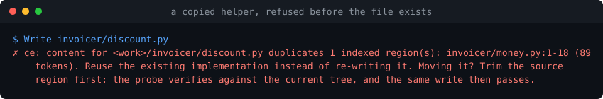
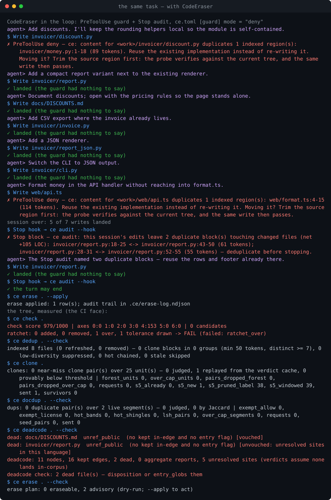

# CodeEraser

[](https://github.com/skymanbp/CodeEraser/actions/workflows/ci.yml) [](https://crates.io/crates/codeeraser) [](https://www.npmjs.com/package/codeeraser) [](LICENSE) [](https://codeeraser.dev) · English | **[中文](README.zh.md)**

> An eraser against LLM-induced code & document entropy.



## What it does

Long-lived LLM-assisted codebases drift the same way: the same function written twice, the same paragraph pasted into three files, files that only ever grow. CodeEraser stops that drift at the moment of writing and gates it in CI, with no model in the loop.

Two refusals happen before the content reaches disk: a write that would *introduce* an exact T1/T2 clone is denied at PreToolUse with the duplicated region named, and a write leaving a file over <!--ce:gate:size.file_lines_fail#digits-->750<!--/ce--> lines (or its `[[rules.class]]` line) is denied the same way. Everything else is a report or a gate: the Stop audit refuses the turn, `ce precommit` / `ce commitmsg` refuse the commit, CI refuses the merge.

**Scope.** Judged: Python, TypeScript/TSX, Rust, Go, Haskell, C, C++, Java, Lua, R, Markdown and HTML (<!--ce:count:langs#word-->thirteen<!--/ce--> language codes, <!--ce:count:grammars#word-->twelve<!--/ce--> tree-sitter grammars). Size-checked only: js/mjs/cjs/jsx, css/scss/less, vue, svelte, sh/bash, yml/yaml. Documentation duplication only: `.txt`. Faces: CLI · GUI (<!--ce:count:screens#word-->eleven<!--/ce--> screens) · Claude Code plugin (<!--ce:count:hooks#word-->four<!--/ce--> hooks, <!--ce:count:skills#word-->one<!--/ce--> skill, <!--ce:count:commands#word-->one<!--/ce--> command, <!--ce:count:mcp_tools#word-->twenty-one<!--/ce--> read-only MCP tools) · pre-commit · CI.

## The effect: the same task, run twice

<!-- scoreboard:begin -->
| | Without CodeEraser | With CodeEraser |
|---|---:|---:|
| writes refused before they reached disk | 0 | **2** |
| duplicate clone blocks left behind | 4 | **0** |
| duplicated doc segments | 1 | **0** |
| removals still owed | 1 | **0** |
| check score | 871 | **979** |

One seven-step task, two identical copies of the seed; the only variable is whether CodeEraser is in the loop — the write-time guard, the Stop audit, and, once the audit refuses, the eraser acting on its own plan. Both runs still end red — not on the same things.
<!-- scoreboard:end -->

A scripted agent replays one seven-step task (*discounts, a compact report, CSV and JSON output, money formatting*) on [`demo/seed`](demo/seed/README.md), a small invoicing service, once without CodeEraser and once with it. Every number above and every refusal below is `ce`'s verbatim output.



<!-- vignettes:begin -->
**A copied helper, refused before the file exists.** Move 1 of the run above, on its own. The reason names the region the content duplicates and the ordering that would pass, so the refusal is actionable rather than a veto.

```console
$ Write invoicer/discount.py
✗ ce: content for <work>/invoicer/discount.py duplicates 1 indexed region(s): invoicer/money.py:1-18 (89 tokens). Reuse the existing implementation instead of re-writing it. Moving it? Trim the source region first: the probe verifies against the current tree, and the same write then passes.
```

**One line, two mouths.** `ce.toml` puts `invoicer/**` on `file_lines_fail = 40`. The write-time guard refuses the write that would cross it, and `ce scan` grades the same tree against the same number — one declaration, read by the hook and by CI.

```console
$ Write invoicer/invoice.py
✗ ce: this write leaves <work>/invoicer/invoice.py at 93 lines, past the hard budget of 40 (plan §4.1). Split the file instead of growing it.
$ ce scan .
FAIL invoicer/invoice.py:1 file-lines = 51 (limit 40) [invoicer/invoice.py]
warn invoicer/report.py:1 file-lines = 35 (limit 30) [invoicer/report.py]
scanned 9 files / 19 functions — 1 warn, 1 fail -> FAIL (failed: hard_line)
```
<!-- vignettes:end -->

The full table, both transcripts and the JSON behind them are in [`demo/README.md`](demo/README.md), replayed byte for byte in CI; the first real interception is recorded in [T1-INTERCEPT](docs/T1-INTERCEPT.md). The precision and recall points are frozen with their evaluation ledgers ([EVAL-SET](docs/EVAL-SET.md), [EVAL-SET-LANGS](docs/EVAL-SET-LANGS.md)).

## How it works


<sub>Zoom and pan this diagram at [codeeraser.dev/how/#verdict](https://codeeraser.dev/how/#verdict).</sub>

- **Write-time clone guard:** normalized tokens winnowed at k = 25, w = 26, so any shared run of 50+ tokens is caught; only *novel* duplication is charged ([FPR-REPLAY](docs/FPR-REPLAY.md)).
- **Near-miss (T3) clones:** candidates from MinHash/LSH, judged in the core by tree edit distance at TSED ≥ 0.85.
- **Documentation duplication that survives rewording:** 5-word shingles, Jaccard ≥ 0.80 or a 50-word verbatim run.
- **Liveness:** per-language resolution ladders feed a reference graph; a four-way verdict comes back with a confidence code.
- **Gate score:** 0–1000 over seven axes, held by the ADR-006 shrink-only ratchet (growth needs `max(+2 %, +10 lines)` or a named re-establish).
- **Deterministic:** no model anywhere; text crosses only the local `ce` → `ce-core` pipe, and the core opens no file.

The rest — same-role advice, Datalog queries and rules, intra-function dead code, merge suggestions, architecture, structure axes, tombstone residue, erase — is on [codeeraser.dev/how](https://codeeraser.dev/how/) and in the methodology booklets.

## Install, run, update

- **Installer.** Each [release](https://github.com/skymanbp/CodeEraser/releases) ships <!--ce:count:installers#word-->five<!--/ce--> GUI installers (NSIS / AppImage / dmg) bundling the GUI, `ce` and the `ce-core` judgment core; the Windows installer runs `ce setup` (AppImage / dmg users run it once), which wires Claude Code. The <!--ce:count:binaries#word-->fifteen<!--/ce--> artifacts are unsigned by decision; verify with `sha256sum -c --ignore-missing SHA256SUMS`.
- **Homebrew / winget.** `brew install skymanbp/codeeraser/codeeraser`; `winget install skymanbp.CodeEraser` once winget-pkgs merges.
- **Claude Code plugin.** `/plugin marketplace add skymanbp/CodeEraser@release`, then `/plugin install codeeraser@codeeraser`.
- **CLI only, or from source.** Put `ce` and `ce-core` side by side on PATH, or `cargo install codeeraser`, or build with GHC <!--ce:tool:ghc#v-->9.14.1<!--/ce--> + cabal; `ce` finds the core as `CE_CORE_BIN` → a `ce-core` sibling → PATH, and `--core <path>` wins.
- **Updating.** `ce update` checks the latest release against its two-phase pins and `--yes` replaces the binaries ([RELEASE](docs/RELEASE.md)).

### Commands

| Command | What it reports / judges |
|---|---|
| `ce scan` / `ce dedup` | size and complexity metrics; T1/T2 clone blocks against the budget |
| `ce clone` / `ce docdup` | T3 near-miss clones; documentation duplication |
| `ce graph` / `ce deadcode` | reference sites and mentions; liveness verdicts |
| `ce churn` / `ce join` / `ce trend` | git-window churn; the three-signal join; score trajectory |
| `ce similar` | same-role units, ranked by the core; advice only |
| `ce query` / `ce rules` | Datalog over the index's facts; rules judged as a gate |
| `ce flow` | dead code inside functions, from the control-flow graph |
| `ce merge` | how a clone group would fold into one function; advice only |
| `ce arch` | directory layers, cycle cuts, clusters, change impact; advice only |
| `ce structure` | <!--ce:count:structure_axes#word-->eight<!--/ce--> structure axes and split pricing |
| `ce check` / `ce baseline` | the ratchet and score floor, <!--ce:count:fail_conditions#word-->six<!--/ce--> named fail conditions |
| `ce erase` | the deterministic two-phase eraser; dry run by default |
| `ce update` | latest release vs this build; `--yes` installs it |
| `ce doctor` / `ce setup` / `ce eject` / `ce mcp` | machine state; Claude Code wiring; uninstall; the MCP server |

Output is English by default and Chinese under `--lang zh`, `CE_LANG=zh` or `[ui] lang = "zh"`. `[[rules.class]]` in `ce.toml` gives one glob set its own lines and ratchet tolerance ([ce.toml reference](docs/reference/ce-toml.md)).

## Three faces, one product

Every capability reaches the CLI, the GUI and the plugin with its MCP server, or is a named omission; the `face_parity` gate derives the sets from the code.

<details><summary>Capability × face table</summary>

<!-- parity:begin -->
| capability | report document (core catalogue) | CLI | GUI (screen · commands) | plugin (hooks · MCP · commands · skills) |
|---|---|---|---|---|
| size / complexity / readability metrics | `scan` | `ce scan` | `reports`, `scan_report` | MCP `scan` |
| T1/T2 clone blocks | `dedup` | `ce dedup` | `reports`, `candidates`, `dedup_report` | MCP `check_duplication` |
| T3 near-miss clones | `clone` | `ce clone` | `reports`, `clone_report` | MCP `clone` |
| the unit universe T3 judges | `clone-units` | `ce clone --units` | `reports`, `clone_report` | MCP `clone` |
| documentation duplication | `docdup` | `ce docdup` | `reports`, `docdup_report` | MCP `docdup` |
| reference sites | `sites` | `ce graph --sites` | `reports`, `sites_report` | MCP `graph_sites` |
| the mention universe | `mentions` | `ce graph --mentions` | — CLI only: the census behind the symbol advisory, which every face of `deadcode` carries | — CLI only: the MCP `deadcode` tool carries the advisory the census feeds |
| liveness verdicts + symbol advisory | `deadcode` | `ce deadcode` | `reports`, `deadcode_report` | MCP `deadcode` |
| graph screen (canvas + liveness) | `graphscreen` | — GUI only: the canvas is a picture; the same judgment's CLI and MCP faces are `deadcode` | `graph`, `graphscreen_report` | — GUI only: the MCP face of the same judgment is `deadcode` |
| git-window churn | `churn` | `ce churn` | `reports`, `churn_report` | MCP `churn` |
| three-signal join | `join` | `ce join` | `candidates`, `join_report` | MCP `join` |
| tree-scale structure (split pricing) | `structure` | `ce structure` | `structure`, `structure_report` | MCP `structure` |
| score trajectory | `trend` | `ce trend` | `trend`, `trend_report` | MCP `trend` |
| score, ratchet and floor | `check` | `ce check` | `score`, `check_report` | MCP `check` |
| same-role advisor (similar units, associative view) | `similar` | `ce similar` | `similar`, `similar_report` | MCP `similar_units` |
| code query and architecture rules | `query`, `rules` | `ce query`, `ce query --prelude`, `ce rules` | `query`, `query_report`, `query_prelude`, `rules_report` | MCP `query`, MCP `rules` |
| intra-function dead code (unreachable, dead stores, unused locals and parameters) | `flow` | `ce flow`, `ce flow --check` | `reports`, `flow_report`, `flow_kinds` | MCP `flow` |
| clone merge suggestions (anti-unification) | `merge` | `ce merge` | `reports`, `merge_report` | MCP `merge_suggestions` |
| architecture analysis (layers, cuts, clusters, impact) | `arch` | `ce arch` | `reports`, `arch_report` | MCP `architecture` |
| baseline writes | — | `ce baseline` | — CLI only: a machine surface never writes a baseline | — |
| erase plan | `erase` | `ce erase` | `erase`, `erase_preview` | MCP `erase`, skill `erase` |
| erase apply | — | `ce erase --apply` | `erase`, `erase_apply` | — no MCP face: applying is a human act |
| erase audit log | `erase-trail` | `ce erase --log` | `erase`, `erase_log_report` | MCP `erase_log` |
| machine state and guard-class tiers | — | `ce doctor` | `doctor`, `doctor_report` | MCP `doctor` |
| update check | — | `ce update` | `update`, `update_check` | MCP `update_check`, `/codeeraser:update`, hook `SessionStart` |
| update apply | — | `ce update --yes` | `update`, `update_apply` | — the plugin's copy is re-pinned by `/plugin update codeeraser` |
| write-time guard | — | `ce probe --hook` (guard · flow · tombstone) | — hooks are the plugin's face; flow and tombstone judge the write inside the hook, so no report family of their own — their tiers ride every face's doctor | hook `PreToolUse` |
| asked-write settlement | — | `ce settle --hook` | — hooks are the plugin's face | hook `PostToolUse` |
| stop audit / git hooks | — | `ce audit --hook` (guard · flow · tombstone), `ce precommit` (guard · flow · tombstone), `ce commitmsg` (guard · flow · tombstone) | — hooks are the plugin's face; precommit and commitmsg are git's; tombstone judges the changeset inside them, its tier on every face's doctor | hook `Stop` |
| session health line | — | `ce health --hook` | — hooks are the plugin's face | hook `SessionStart` |
| project daemon | — | `ce daemon`, `ce ping` | — started lazily by every face | — |
| read-only report server | — | `ce mcp` | — the plugin registers it | `.mcp.json` |
| uninstall | — | `ce eject` | — CLI only | — |
| Claude Code wiring | — | `ce setup`, `ce setup --unwire` | — CLI only: the Windows installer calls it, AppImage / dmg users run it once | — |
| root anchoring | — | — every command and hook anchors through `root` | `default_root`, `resolve_root` | — |
<!-- parity:end -->

</details>

## Tech stack and philosophy


<sub>Zoom and pan this diagram at [codeeraser.dev/#architecture](https://codeeraser.dev/#architecture).</sub>

- **Rust <!--ce:tool:rust#v-->1.94.1<!--/ce-->** (edition <!--ce:tool:edition#name-->2024<!--/ce-->): tree-sitter <!--ce:tool:tree_sitter#vminor-->0.27<!--/ce--> with <!--ce:count:grammars#word-->twelve<!--/ce--> grammars, rusqlite <!--ce:tool:rusqlite#vminor-->0.40<!--/ce--> (index schema <!--ce:ver:schema.index#digits-->17<!--/ce--> / GRAPH_REV <!--ce:ver:graph_rev#digits-->23<!--/ce--> / MENTION_REV <!--ce:ver:mention_rev#digits-->4<!--/ce-->), a per-project daemon.
- **Haskell (GHC <!--ce:tool:ghc#v-->9.14.1<!--/ce-->)**: `ce-core`, every judgment family. **Tauri <!--ce:tool:tauri#digits-->2<!--/ce-->**: the GUI over the same crate.
- **One wire:** NDJSON over stdio (proto <!--ce:ver:proto#v-->9.0.0<!--/ce-->, <!--ce:count:families#word-->sixteen<!--/ce--> families); the daemon speaks its own protocol (<!--ce:ver:daemon#v-->2.3.0<!--/ce-->).
- **Design rules:** ADR-001 … ADR-009 (Rust frontend, parse layer in Rust, lazy daemon, cheap PreToolUse, two clone layers, shrink-only ratchet, pinned distribution, policy as Haskell data, derived documentation facts) in [DEVELOPMENT_PLAN](docs/DEVELOPMENT_PLAN.md).
- **Philosophy.** Measure in Rust, decide and write in Haskell, print everywhere else. Nothing asks a model anything; hooks fail open and say so; documentation is generated or gated, including the <!--ce:count:booklets#word-->nineteen<!--/ce-->-booklet [methodology](docs/reference/methodology.md), and every push runs the <!--ce:count:gates#word-->seven<!--/ce--> product gates on this tree.

## Known limits

PreToolUse shapes behaviour; it is not a security wall (shell writes bypass it; the Stop audit and CI are the backstops). Hooks fail open on internal errors and record the degradation.

- **Languages.** AST judgment uses the <!--ce:count:grammars#word-->twelve<!--/ce--> grammars above; Markdown, HTML and `.txt` are judged by the documentation and graph rules; T4 clones are not promised.
- **Advice, never a verdict.** Symbol-level liveness, `ce similar`, `ce merge` and `ce arch` never fail a gate; a guard class stays `observe` until it has its own false-positive record.
- **Lines not drawn.** `cognitive_fail` defaults to 0 (complexity only warns), and `ce structure` has no score floor.
- **Distribution.** A release builds <!--ce:count:platforms#word-->five<!--/ce--> targets; `ce setup` wires nothing from an elevated account that is not the logged-in user (exit 13); judging this repository needs the `cli/tests` submodule seated.
- **One wire line.** A request line to the core is at most <!--ce:gate:wire.line_bytes#digits-->134,217,728<!--/ce--> bytes; larger requests split into batches, and an oversized item is refused by name, never truncated.

Scores are not comparable across a `[[rules.class]]` switch, across a named re-establish that moves `softLine`, or across these releases: v0.7.3 → v1.0.0, v1.2.0 → v1.3.0, v1.3.x → v1.4.0, v1.6.0 → v1.7.0, v1.7.4 → v1.8.0, v1.8.0 → v1.9.0 (1.9.1 and 1.9.2 are comparable with 1.9.0); the reasons are in [CHANGELOG](CHANGELOG.md).

## Documentation

- [CLI reference](docs/reference/cli.md) · [ce.toml reference](docs/reference/ce-toml.md) (generated from the binary and the config schema; drift reddens CI) · [Methodology](docs/reference/methodology.md) (<!--ce:count:booklets#word-->nineteen<!--/ce--> booklets, cited to implementation lines) · [structure axes](docs/reference/structure-axes.md) · [size advisory](docs/reference/size-advisory.md) · [erase contract](docs/reference/erase.md) · [GUI reference](docs/reference/gui.md) · [plugin](plugin/README.md) · [demo](demo/README.md)
- [DEVELOPMENT_PLAN](docs/DEVELOPMENT_PLAN.md) · [EVAL-SET](docs/EVAL-SET.md) · [EVAL-SET-SIMILAR](docs/EVAL-SET-SIMILAR.md) · [EVAL-SET-LANGS](docs/EVAL-SET-LANGS.md) · [EVAL-SET-FLOW](docs/EVAL-SET-FLOW.md) · [language-expansion](docs/reference/language-expansion.md) · [FIELD-TEST](docs/FIELD-TEST.md) · [PERF-BUDGET](docs/PERF-BUDGET.md) · [FPR-REPLAY](docs/FPR-REPLAY.md) · [FPR-TOMBSTONE](docs/FPR-TOMBSTONE.md) · [FPR-L2](docs/FPR-L2.md) · [T1-INTERCEPT](docs/T1-INTERCEPT.md) · [contracts/VERSIONING.md](contracts/VERSIONING.md) · [docs/RELEASE.md](docs/RELEASE.md) (wire SemVer and the two-phase release runbook)
- Website: [codeeraser.dev](https://codeeraser.dev) · [how it works](https://codeeraser.dev/how/) · [math](https://codeeraser.dev/math/) · [stack](https://codeeraser.dev/stack/) <!-- ce:allow(docdup) -- the documentation links are one set, listed in both languages -->

## License

Apache-2.0; see [LICENSE](LICENSE). Third-party inventory in [NOTICE](NOTICE) (regenerated and gated in CI). The test suite lives in [skymanbp/CodeEraser-tests](https://github.com/skymanbp/CodeEraser-tests); clone with `--recurse-submodules`. "CodeEraser"™ is a trademark of skymanbp; per Apache-2.0 §6 the license covers the code, not the name.
