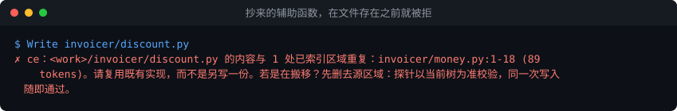

# CodeEraser

**[English](README.md)** | 中文（徽章行只住英文 README，两份文件里逐字节相同的块正是本工具判死的冗余）

> 对抗 LLM 引致的代码与文档熵增的橡皮擦。



## 它做什么

LLM 协作的代码库都往同一个方向漂：同一个函数写两遍、同一段话贴进三个文件、文件只增不减。CodeEraser 在这种写入落盘之前就拒掉它，全程没有任何模型参与。

- 复制了树里已有代码的写入会被拒绝，拒绝理由指名它重复的是哪一块。
- 让文件超过 <!--ce:gate:size.file_lines_fail#digits-->750<!--/ce--> 行的写入同样被拒绝。
- 其余一切都是报告或门：Stop 审计拒绝结束本轮，`ce precommit` 拒绝提交，CI 拒绝合入。

**判决** Python、TypeScript/TSX、Rust、Go、Haskell、C、C++、Java、Lua、R、Markdown、HTML（<!--ce:count:langs#word-->十三<!--/ce-->个语言码，<!--ce:count:grammars#word-->十二<!--/ce-->套 tree-sitter 语法）；JS、CSS、Vue、Svelte、shell、YAML 只查尺寸；`.txt` 只查文档重复。

**形态** CLI · GUI（<!--ce:count:screens#word-->十一<!--/ce-->屏）· Claude Code 插件（<!--ce:count:hooks#word-->四<!--/ce-->钩、<!--ce:count:skills#word-->一<!--/ce--> skill、<!--ce:count:commands#word-->一<!--/ce-->命令、<!--ce:count:mcp_tools#word-->二十一<!--/ce-->个只读 MCP 工具）· pre-commit · CI。

## 实际效果：同一任务，跑两遍

<!-- scoreboard:begin -->
| | 不带 CodeEraser | 带 CodeEraser |
|---|---:|---:|
| 文件落盘前被拒绝的写入 | 0 | **2** |
| 残留的克隆块 | 4 | **0** |
| 重复文档段 | 1 | **0** |
| 仍欠的删除 | 1 | **0** |
| 检查分数 | 871 | **979** |

同一个七步任务，两份完全相同的种子树；唯一的变量是 CodeEraser 在不在环内——写入时的守卫、Stop 审计，以及审计拒绝之后按自己的计划执行的擦除。两次都仍以红色收场——但红的不是同一件事。
<!-- scoreboard:end -->

脚本化的 agent 在 [`demo/seed`](demo/seed/README.md)（一个小型开票服务）上把同一个七步任务（*折扣、紧凑报表、CSV 与 JSON 输出、金额格式化*）重放两遍，一遍不带 CodeEraser，一遍带。上面每个数字、下面每条拒绝都是 `ce` 的逐字输出。


<!-- vignettes:begin -->
**抄来的辅助函数，在文件存在之前就被拒。** 上表第 1 步单独拿出来。理由点名这段内容重复了哪块区域、以及怎样排序才能通过——所以这是一条可执行的拒绝，不是一张否决票。

```console
$ Write invoicer/discount.py
✗ ce：<work>/invoicer/discount.py 的内容与 1 处已索引区域重复：invoicer/money.py:1-18 (89 tokens)。请复用既有实现，而不是另写一份。若是在搬移？先删去源区域：探针以当前树为准校验，同一次写入随即通过。
```

**一条线，两张嘴。** `ce.toml` 给 `invoicer/**` 定下 `file_lines_fail = 40`。写入时守卫拒绝会越线的那次写入，`ce scan` 用同一个数给同一棵树评级——一处声明，钩子与 CI 同读。

```console
$ Write invoicer/invoice.py
✗ ce：这次写入会让 <work>/invoicer/invoice.py 达到 93 行，越过 40 行的硬预算（计划 §4.1）。请拆分文件，而不是继续让它长大。
$ ce scan .
FAIL invoicer/invoice.py:1 file-lines = 51（上限 40）[invoicer/invoice.py]
warn invoicer/report.py:1 file-lines = 35（上限 30）[invoicer/report.py]
已扫描 9 文件 / 19 函数 — 1 warn，1 fail -> FAIL（失败条件：hard_line）
```
<!-- vignettes:end -->

完整对照表、两份转录与背后的 JSON 在 [`demo/README.md`](demo/README.md)，并在 CI 里逐字节重放；第一次真实拦截记在 [T1-INTERCEPT](docs/T1-INTERCEPT.md)。精度与召回点随各自的评估台账冻结（[EVAL-SET](docs/EVAL-SET.md)、[EVAL-SET-LANGS](docs/EVAL-SET-LANGS.md)）。

## 工作原理


<sub>在 [codeeraser.dev/zh/how/#verdict](https://codeeraser.dev/zh/how/#verdict) 可缩放、拖动查看此图。</sub>

- **写入时克隆守卫：** 规范化 token 以 k = 25、w = 26 做 winnowing，任何 50+ token 的共享片段都逃不掉；只计**新引入**的重复（[FPR-REPLAY](docs/FPR-REPLAY.md)）。
- **近似（T3）克隆：** MinHash/LSH 出候选，核以树编辑距离判定，TSED ≥ 0.85。
- **改过措辞也逃不掉的文档重复：** 5 词 shingle，Jaccard ≥ 0.80 或 50 词逐字连续段。
- **存活性：** 逐语言的解析阶梯喂出引用图，四态判决带置信码返回。
- **门分数：** 七轴上的 0–1000，由 ADR-006 只收紧的棘轮守住（增长要在 `max(+2 %, +10 行)` 内，否则具名重立）。
- **确定性：** 全程无模型；文本只经本机 `ce` → `ce-core` 管道过线，核不开任何文件。

其余——同角色建议、Datalog 查询与规则、函数内死代码、合并建议、架构、结构轴、墓碑残留、擦除——见 [codeeraser.dev/zh/how](https://codeeraser.dev/zh/how/) 与方法学各册。

## 安装、运行与更新

- **安装包。** 每个 [release](https://github.com/skymanbp/CodeEraser/releases) 发<!--ce:count:installers#word-->五<!--/ce-->个 GUI 安装包（NSIS / AppImage / dmg），内含 GUI、`ce` 与判决核 `ce-core`；Windows 安装包会运行 `ce setup` 接入 Claude Code（AppImage / dmg 用户自己跑一次）。<!--ce:count:binaries#word-->十五<!--/ce-->件产物按裁定不签名；用 `sha256sum -c --ignore-missing SHA256SUMS` 校验。
- **Homebrew / winget。** `brew install skymanbp/codeeraser/codeeraser`；`winget install skymanbp.CodeEraser` 须等 winget-pkgs 合并之后。
- **Claude Code 插件。** `/plugin marketplace add skymanbp/CodeEraser@release`，再 `/plugin install codeeraser@codeeraser`。
- **只要 CLI，或从源码。** 把 `ce` 与 `ce-core` 并排放上 PATH，或 `cargo install codeeraser`，或用 GHC <!--ce:tool:ghc#v-->9.14.1<!--/ce--> + cabal 构建；核按 `CE_CORE_BIN` → 旁边的 `ce-core` → PATH 解析，`--core <路径>` 最优先。
- **更新。** `ce update` 按两段式 pin 对比最新发布，`--yes` 替换二进制（[RELEASE](docs/RELEASE.md)）。

### 命令

| 命令 | 报告 / 判决内容 |
|---|---|
| `ce scan` / `ce dedup` | 尺寸与复杂度度量；对照预算的 T1/T2 克隆块 |
| `ce clone` / `ce docdup` | T3 近似克隆；文档重复 |
| `ce graph` / `ce deadcode` | 引用站点与提及；存活性判决 |
| `ce churn` / `ce join` / `ce trend` | git 窗口变动；三信号联判；分数轨迹 |
| `ce similar` | 核排序的同角色单元；只当顾问 |
| `ce query` / `ce rules` | 索引事实上的 Datalog；规则当门判 |
| `ce flow` | 函数内死代码，取自控制流图 |
| `ce merge` | 一组克隆怎样折成一个函数；只当顾问 |
| `ce arch` | 目录分层、拆环、聚类、改动影响面；只当顾问 |
| `ce structure` | <!--ce:count:structure_axes#word-->八<!--/ce-->个结构轴与拆分定价 |
| `ce check` / `ce baseline` | 棘轮与分数地板，<!--ce:count:fail_conditions#word-->六<!--/ce-->个具名 fail 条件 |
| `ce erase` | 确定性两段式擦除；默认演练 |
| `ce update` | 最新发布对比本构建；`--yes` 安装 |
| `ce doctor` / `ce setup` / `ce eject` / `ce mcp` | 本机状态；Claude Code 接线；卸载；MCP 服务器 |

输出默认英文，`--lang zh`、`CE_LANG=zh` 或 `[ui] lang = "zh"` 切中文。`ce.toml` 里的 `[[rules.class]]` 给一组 glob 自己的线与棘轮容差（[ce.toml 参考](docs/reference/ce-toml.md)）。

## 三面一体

每项能力都到达 CLI、GUI 与带 MCP 服务器的插件，否则就是具名缺席；`face_parity` 门从代码派生各集合。

<details><summary>能力 × 面 对照表</summary>

<!-- parity:begin -->
| 能力 | 报告文档（核目录） | CLI | GUI（屏 · 命令） | 插件（hooks · MCP · 命令 · skill） |
|---|---|---|---|---|
| 尺寸 / 复杂度 / 可读性度量 | `scan` | `ce scan` | `reports`, `scan_report` | MCP `scan` |
| T1/T2 克隆块 | `dedup` | `ce dedup` | `reports`, `candidates`, `dedup_report` | MCP `check_duplication` |
| T3 近似克隆 | `clone` | `ce clone` | `reports`, `clone_report` | MCP `clone` |
| T3 所判的单元宇宙 | `clone-units` | `ce clone --units` | `reports`, `clone_report` | MCP `clone` |
| 文档重复 | `docdup` | `ce docdup` | `reports`, `docdup_report` | MCP `docdup` |
| 引用站点 | `sites` | `ce graph --sites` | `reports`, `sites_report` | MCP `graph_sites` |
| 提及宇宙 | `mentions` | `ce graph --mentions` | — 只在 CLI：符号顾问背后的普查，`deadcode` 的每一面都带着顾问本身 | — 只在 CLI：MCP `deadcode` 工具带着这份普查所喂的顾问 |
| 存活性判决 + 符号顾问 | `deadcode` | `ce deadcode` | `reports`, `deadcode_report` | MCP `deadcode` |
| 图屏（画布 + 存活性） | `graphscreen` | — 只在 GUI：画布是一张图；同一判决的 CLI 与 MCP 面是 `deadcode` | `graph`, `graphscreen_report` | — 只在 GUI：同一判决的 MCP 面是 `deadcode` |
| git 窗口变动 | `churn` | `ce churn` | `reports`, `churn_report` | MCP `churn` |
| 三信号联判 | `join` | `ce join` | `candidates`, `join_report` | MCP `join` |
| 树尺度结构（拆分定价） | `structure` | `ce structure` | `structure`, `structure_report` | MCP `structure` |
| 分数轨迹 | `trend` | `ce trend` | `trend`, `trend_report` | MCP `trend` |
| 分数、棘轮与地板 | `check` | `ce check` | `score`, `check_report` | MCP `check` |
| 同角色顾问（相似单元、联想视图） | `similar` | `ce similar` | `similar`, `similar_report` | MCP `similar_units` |
| 代码查询与架构规则 | `query`, `rules` | `ce query`, `ce query --prelude`, `ce rules` | `query`, `query_report`, `query_prelude`, `rules_report` | MCP `query`, MCP `rules` |
| 函数内死代码（不可达、死存储、未用局部量与形参） | `flow` | `ce flow`, `ce flow --check` | `reports`, `flow_report`, `flow_kinds` | MCP `flow` |
| 克隆合并建议（反统一） | `merge` | `ce merge` | `reports`, `merge_report` | MCP `merge_suggestions` |
| 架构分析（分层、拆环、簇、影响面） | `arch` | `ce arch` | `reports`, `arch_report` | MCP `architecture` |
| 基线写入 | — | `ce baseline` | — 只在 CLI：机器面永不写基线 | — |
| 擦除计划 | `erase` | `ce erase` | `erase`, `erase_preview` | MCP `erase`, skill `erase` |
| 擦除执行 | — | `ce erase --apply` | `erase`, `erase_apply` | — 无 MCP 面：执行是人类动作 |
| 擦除审计日志 | `erase-trail` | `ce erase --log` | `erase`, `erase_log_report` | MCP `erase_log` |
| 本机状态与守卫类档位 | — | `ce doctor` | `doctor`, `doctor_report` | MCP `doctor` |
| 更新检查 | — | `ce update` | `update`, `update_check` | MCP `update_check`, `/codeeraser:update`, hook `SessionStart` |
| 更新执行 | — | `ce update --yes` | `update`, `update_apply` | — 插件副本由 `/plugin update codeeraser` 重钉 |
| 写入时守卫 | — | `ce probe --hook` (guard · flow · tombstone) | — 钩子即插件之面；flow 与 tombstone 在钩子里判这次写入，故无自己的报告家族——它们的档位随每一面的 doctor 出示 | hook `PreToolUse` |
| ask 档写入的落地记录 | — | `ce settle --hook` | — 钩子即插件之面 | hook `PostToolUse` |
| Stop 审计 / git 钩子 | — | `ce audit --hook` (guard · flow · tombstone), `ce precommit` (guard · flow · tombstone), `ce commitmsg` (guard · flow · tombstone) | — 钩子即插件之面；precommit 与 commitmsg 挂在 git 里；tombstone 在其中判改动集，档位见每一面的 doctor | hook `Stop` |
| 会话健康行 | — | `ce health --hook` | — 钩子即插件之面 | hook `SessionStart` |
| 项目 daemon | — | `ce daemon`, `ce ping` | — 每一面惰性启动 | — |
| 只读报告服务器 | — | `ce mcp` | — 插件自行注册 | `.mcp.json` |
| 卸载 | — | `ce eject` | — 只在 CLI | — |
| Claude Code 接线 | — | `ce setup`, `ce setup --unwire` | — 只在 CLI：Windows 安装包调用它，AppImage / dmg 用户装后跑一次 | — |
| 根锚定 | — | — 每条命令与钩子都经 `root` 锚定 | `default_root`, `resolve_root` | — |
<!-- parity:end -->

</details>

## 技术栈与哲学


<sub>在 [codeeraser.dev/zh/#architecture](https://codeeraser.dev/zh/#architecture) 可缩放、拖动查看此图。</sub>

- **Rust <!--ce:tool:rust#v-->1.94.1<!--/ce-->**（edition <!--ce:tool:edition#name-->2024<!--/ce-->）：tree-sitter <!--ce:tool:tree_sitter#vminor-->0.27<!--/ce--> 与<!--ce:count:grammars#word-->十二<!--/ce-->套语法、rusqlite <!--ce:tool:rusqlite#vminor-->0.40<!--/ce-->（索引 schema <!--ce:ver:schema.index#digits-->17<!--/ce--> / GRAPH_REV <!--ce:ver:graph_rev#digits-->23<!--/ce--> / MENTION_REV <!--ce:ver:mention_rev#digits-->4<!--/ce-->）、逐项目 daemon。
- **Haskell（GHC <!--ce:tool:ghc#v-->9.14.1<!--/ce-->）**：`ce-core`，每个判决家族。**Tauri <!--ce:tool:tauri#digits-->2<!--/ce-->**：同一 crate 之上的 GUI。
- **一条 wire：** stdio 上的 NDJSON（proto <!--ce:ver:proto#v-->9.0.0<!--/ce-->，<!--ce:count:families#word-->十六<!--/ce-->个家族）；daemon 讲自己的协议（<!--ce:ver:daemon#v-->2.3.0<!--/ce-->）。
- **设计规则：** ADR-001 … ADR-009（Rust 前端、解析层归 Rust、懒启动 daemon、廉价 PreToolUse、两层克隆、只收紧的棘轮、钉扎分发、策略即 Haskell 数据、文档事实派生）见 [DEVELOPMENT_PLAN](docs/DEVELOPMENT_PLAN.md)。
- **哲学。** 在 Rust 里度量，在 Haskell 里裁决并成文，在其余一切面上印出。不问模型任何事；钩子失败开放并明说；文档要么生成要么门控，包括<!--ce:count:booklets#word-->十九<!--/ce-->册[方法学](docs/reference/methodology.md)；每次 push 都在这棵树上跑<!--ce:count:gates#word-->七<!--/ce-->道产品门。

## 已知限制

PreToolUse 塑造行为，不是安全墙（shell 写入绕过它，Stop 审计与 CI 是兜底）。钩子遇内部错误失败开放并记录降级。

- **语言。** 基于 AST 的判决使用上述<!--ce:count:grammars#word-->十二<!--/ce-->套语法；Markdown、HTML 与 `.txt` 由文档与图规则判决；不承诺 T4 克隆。
- **只当顾问，永不是判决。** 符号层存活性、`ce similar`、`ce merge` 与 `ce arch` 从不让门变红；守卫类拿出自己的误报记录之前一律停在 `observe`。
- **不替你画的线。** `cognitive_fail` 默认 0（复杂度只 warn），`ce structure` 不设分数地板。
- **分发。** 一次发布构建<!--ce:count:platforms#word-->五<!--/ce-->个目标；提权账户不是登录用户时 `ce setup` 什么都不接（退出码 13）；判决本仓需要 `cli/tests` submodule 就位。
- **协议一行。** 送核的一行请求至多 <!--ce:gate:wire.line_bytes#digits-->134,217,728<!--/ce--> 字节；更大的请求分批送，单独超线的一项按名拒绝，从不截断。

跨 `[[rules.class]]` 开关、跨一次挪动 `softLine` 的具名重立、跨这些版本的分数都不可比：v0.7.3 → v1.0.0、v1.2.0 → v1.3.0、v1.3.x → v1.4.0、v1.6.0 → v1.7.0、v1.7.4 → v1.8.0、v1.8.0 → v1.9.0（1.9.1、1.9.2 与 1.9.0 可比）；原因见 [CHANGELOG](CHANGELOG.md)。

## 文档

- [CLI 参考](docs/reference/cli.md) · [ce.toml 参考](docs/reference/ce-toml.md)（由二进制与配置 schema 生成，漂移即 CI 变红）· [方法学](docs/reference/methodology.md)（<!--ce:count:booklets#word-->十九<!--/ce-->册，引到实现行）· [结构轴](docs/reference/structure-axes.md) · [尺寸顾问](docs/reference/size-advisory.md) · [擦除契约](docs/reference/erase.md) · [GUI 参考](docs/reference/gui.md) · [插件](plugin/README.md) · [demo](demo/README.md)
- [DEVELOPMENT_PLAN](docs/DEVELOPMENT_PLAN.md) · [EVAL-SET](docs/EVAL-SET.md) · [EVAL-SET-SIMILAR](docs/EVAL-SET-SIMILAR.md) · [EVAL-SET-LANGS](docs/EVAL-SET-LANGS.md) · [EVAL-SET-FLOW](docs/EVAL-SET-FLOW.md) · [language-expansion](docs/reference/language-expansion.md) · [FIELD-TEST](docs/FIELD-TEST.md) · [PERF-BUDGET](docs/PERF-BUDGET.md) · [FPR-REPLAY](docs/FPR-REPLAY.md) · [FPR-TOMBSTONE](docs/FPR-TOMBSTONE.md) · [FPR-L2](docs/FPR-L2.md) · [T1-INTERCEPT](docs/T1-INTERCEPT.md) · [contracts/VERSIONING.md](contracts/VERSIONING.md) · [docs/RELEASE.md](docs/RELEASE.md)（wire SemVer 与两段式发布 runbook）
- 官网：[codeeraser.dev/zh](https://codeeraser.dev/zh/) · [工作原理](https://codeeraser.dev/zh/how/) · [数学](https://codeeraser.dev/zh/math/) · [技术栈](https://codeeraser.dev/zh/stack/) <!-- ce:allow(docdup) -- 文档链接是同一集合，两种语言各列一遍 -->

## 许可证

Apache-2.0，见 [LICENSE](LICENSE)；第三方清单在 [NOTICE](NOTICE)（CI 再生成并门控）。测试套件在 [skymanbp/CodeEraser-tests](https://github.com/skymanbp/CodeEraser-tests)；clone 时带 `--recurse-submodules`。"CodeEraser"™ 为 skymanbp 商标；按 Apache-2.0 §6，许可证覆盖代码，不授予名称。
